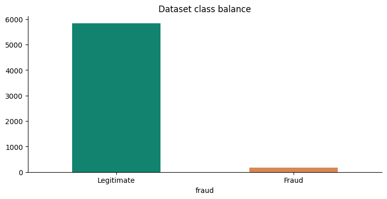
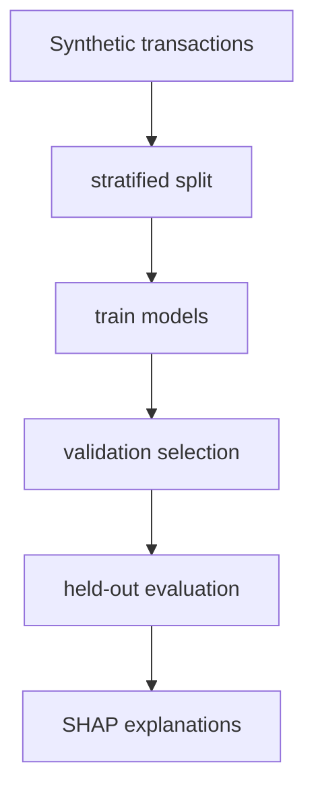

# Sentinel Fraud

An explainable transaction-risk laboratory comparing Logistic Regression, Random Forest and XGBoost on reproducible synthetic financial transactions.



**Scikit-learn pipelines · XGBoost · SHAP · FastAPI · pandas**

## What it does

- CSV import validates the six feature columns and batch-scores up to 1,000 rows. Try `data/sample_transactions.csv`. Imported data is not stored.
- Seeded generator produces 6,000 transactions with imbalanced, noisy labels.
- Train/validation/test split is 60/20/20. No test-set threshold or model selection.
- Models selected by validation average precision; thresholds maximize validation F1.
- Dashboard shows held-out precision, recall, F1, AP, false-positive rate and review queue.
- Individual prediction endpoint returns SHAP contributions for all three models.
- Executed notebook covers EDA, precision–recall/ROC curves, confusion matrix, threshold trade-offs, bootstrap intervals and SHAP beeswarm/waterfall plots.

## Run locally

Requires Python 3.12+. Run each project in its own virtual environment.

```bash
git clone https://github.com/Izu-kun23/sentinel-fraud.git
cd sentinel-fraud
python -m venv .venv
source .venv/bin/activate
# Windows PowerShell: .venv\Scripts\Activate.ps1
python -m pip install -r requirements.txt
python -m uvicorn app.main:app --host 127.0.0.1 --port 8002
```

Open **http://localhost:8002**. Interactive OpenAPI documentation: **http://localhost:8002/docs**. The compiled Tailwind stylesheet is checked in, so running the app needs no Node build, CDN, cloud database or frontend keys. The responsive frontend uses semantic HTML, Tailwind CSS and browser JavaScript, served from the same origin as the API.

## Architecture



```text
app/
  domain/          Pure data contracts and algorithms
  services/        Application workflows and model orchestration
  infrastructure/ External providers and persistence adapters
  web/             Responsive dashboard and API client
  main.py          HTTP composition root and validation
data/              Reproducible demo corpus or local runtime storage
notebooks/         Executable analysis with saved outputs
tests/             Domain and API regression tests
```

HTTP routes validate inputs and delegate to services. Domain code contains the core rules. Infrastructure handles persistence and external providers. The same functions power notebooks and the application, preventing separate analysis and serving implementations.

## API

`POST /api/transactions/import` accepts a JSON `csv` string. `GET /api/overview`, `POST /api/predict?model=Random%20Forest` with `amount`, `hour`, `distance_km`, `transactions_24h`, `account_age_days`, `international`.

All endpoints are documented and callable in `/docs`. Errors use standard FastAPI status codes and a `detail` payload. `GET /api/health` is available for health checks.

## Notebook-led analysis and verification

```bash
python -m pip install -r requirements.lock
python -m pytest -q
# Optional DOM interaction checks (Node 24+)
npm ci
npm run test:ui
python -m pip install jupyterlab
python -m jupyter lab notebooks
```

The three notebooks in [notebooks/](notebooks/README.md) cover the baseline analysis, deeper experiments and operational audits. Open them in numerical order and choose **Run All**. Checked-in outputs are generated from real executions on bundled data, not hand-entered results. See [verification](docs/verification.md) for measured outcomes and scope.

## Configuration and limitations

For analysis on your own labelled dataset, set `SENTINEL_ANALYSIS_CSV=/absolute/path/data.csv` before launching Jupyter; the notebook trains all three models using that CSV and requires a binary `fraud` column.

Training runs lazily on first access and is deterministic; each worker keeps its own in-memory models. A first request is slower. No serialized untrusted model is loaded. Scores are uncalibrated model estimates trained on synthetic data, not validated real-world fraud probabilities. No financial decisions should be automated from this demo. SHAP describes model behaviour, not causation. A real deployment requires licensed data, chronological/customer-group splits, calibration, fairness checks and drift monitoring.

Local persistence lives in `data/`; runtime database/model files and secrets are excluded from git. Configuration variables are described in `.env.example`.

## Docker

```bash
docker build -t sentinel-fraud .
docker run --rm -p 8002:8000 sentinel-fraud
```

The container runs as a non-root user. Data is ephemeral unless a writable volume is mounted at `/app/data`. Pass explicit `-e` variables for optional providers.

## Deployment boundary

This is a functioning local portfolio application, not a multi-tenant production service. There is no authentication or per-user isolation. Keep the default localhost binding; add authentication, rate limiting, request budgets, TLS, structured observability and an egress policy before public deployment. External API usage should have spend limits. Notebook results are small-data evidence, not production benchmarks.

## Tailwind UI development

Each interface uses **Tailwind CSS 4**, compiled locally rather than loaded from a CDN. The source is `app/web/tailwind.css`; `@apply` defines rounded cards, controls, tables and dashboard chrome, while HTML utilities handle typography and layout. Each product uses one accent palette and neutral surfaces.

```bash
npm ci
npm run build:css
# Watch while editing:
npm run dev:css
```

Commit both the stylesheet source and compiled output after UI changes. GitHub correctly treats the compiled CSS as generated; executable notebooks are explicitly included in GitHub language statistics under their detected file type.

## Design and implementation

The UI includes responsive layouts, accessible form labels, loading/error states, empty states, keyboard-focus styles and safe rendering of source/user content. No analytics tracker or external font request is required.

## License

MIT · Izuchukwu Tony
